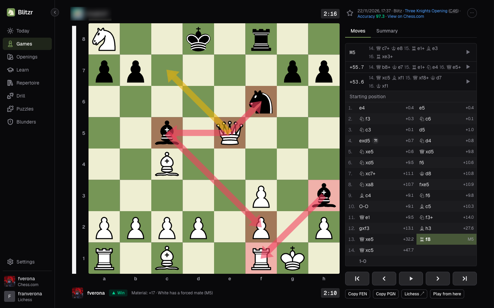
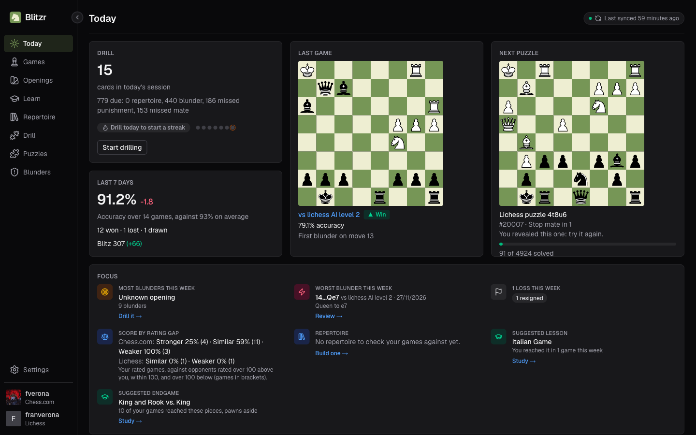
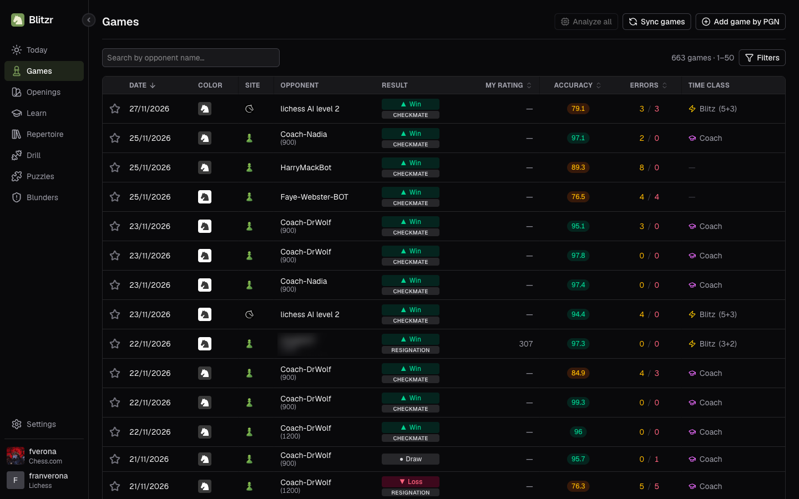

<div align="center">


<h3>Blitzr</h3>

Train on your own blunders, not generic puzzles — a local chess trainer built from your real Chess.com and Lichess games.

</div>

## What this is

A **personal side project**, not a product: it runs on one machine, for one person, against that
person's Chess.com and/or Lichess history. No hosted version, no accounts, no multi-user support.

**Blitzr is unaffiliated with Chess.com and Lichess** and doesn't use their names, logos or marks in
any way that implies endorsement.

## Features

- **Sync** from Chess.com's [Published-Data API](https://www.chess.com/news/view/published-data-api)
  and the [Lichess API](https://lichess.org/api) (either or both), plus adding any game by PGN
- **Games list** with search, filters (result, color, rated, site, time class, accuracy,
  favorites) and sorting by date, rating, accuracy or errors
- **Game page**: replay with player strips and clocks, in-browser Stockfish analysis (blunders with
  plain-English tactical explanations, move quality, accuracy by phase, eval graph, a written
  summary), live engine lines, free exploration, and playing any position out against Stockfish
  (~800–2500 Elo)
- **Openings** by ECO and a **repertoire** you build, with deviation detection and a quiz
- **Drill**: spaced-repetition cards from your deviations, blunders, missed punishments and missed
  mates
- **Blunders**: cross-game stats (by opening, piece, tactic, phase, clock), won positions you didn't
  win, and an accuracy trend
- **Learn**: opening, endgame and classic-position lessons with study, quiz and play-it-out modes
- **Puzzles**: mate-in-N and defence puzzles
- **Today**: what's due, what's unanalyzed, and how last week went
- **Settings**: theme, board colors, piece set, notation, sounds, analysis strength, drill size,
  backups. English and Spanish UI.

## Screenshots







## Getting started

Needs Node 22.18+ (`.nvmrc`).

```bash
npm install -g pnpm
pnpm install
cp .env.example .env.local   # set CHESSCOM_USERNAME, LICHESS_USERNAME or both
pnpm dev
```

Open [http://localhost:3000](http://localhost:3000), go to **Games** and click **Sync games**. Later
syncs only fetch incomplete months, and run on their own when you open Blitzr an hour after the last
one. `.env.example` documents the other settings (`NEXT_PUBLIC_LOCALE=es` for Spanish,
`BLITZR_DATA_DIR`, `BLITZR_AUTO_SYNC_MINUTES`, `BLITZR_PGN_INBOX`).

### Backups

The database is `data/blitzr.db` (or under `BLITZR_DATA_DIR`). Your repertoire, drill schedules and
progress can't be rebuilt by re-syncing, so back up before updating: `pnpm backup` (writes to
`data/backups/`) or Settings → Data → **Download backup**. A schema change also saves
`data/backups/pre-migration-<time>.db` first. To restore, stop Blitzr, delete `data/blitzr.db-wal`
and `data/blitzr.db-shm` if present, and replace `data/blitzr.db`.

## Running as a background service (pm2)

`pnpm start` and `pnpm dev` bind to `127.0.0.1` only: Server Actions edit your data with no auth.

```bash
npm install -g pm2
pnpm build
pm2 start "pnpm start -p 9877" --name blitzr
pm2 save
pm2 startup   # follow the printed command to register with launchd
```

To update:

```bash
pnpm backup && git pull --ff-only && pnpm install && pnpm build && pm2 restart blitzr
```

`pnpm build` rewrites `.next/`, which a running `pnpm dev` or pm2 server reads from: restart it after
a build. If the build fails, go back to the version you had (then `git switch main` before the next
update):

```bash
git switch --detach ORIG_HEAD && pnpm install && pnpm build && pm2 restart blitzr
```

## Scripts

```bash
pnpm test            # Vitest (pnpm test:watch to watch)
pnpm lint            # ESLint
pnpm format          # Prettier (pnpm format:check to check)
pnpm backup          # copy the database into data/backups/
```

### Before merging

CI runs these on every PR, after `pnpm audit --prod`, then smoke-tests the built app:

```bash
pnpm format:check
pnpm exec tsc --noEmit
pnpm lint
pnpm test
pnpm build
```

### Puzzle and lesson scripts

Not needed to run Blitzr (the Lichess puzzles ship in `lib/`). Re-running them keeps puzzle ids, and
so solved progress.

| Script                             | Does                                                                     | Needs                                          |
| ---------------------------------- | ------------------------------------------------------------------------ | ---------------------------------------------- |
| `import-lichess-mates.mjs`         | writes `lib/lichessMates.json`                                           | the Lichess puzzle CSV on stdin (or as a path) |
| `import-lichess-defenses.mjs`      | writes `lib/lichessDefenses.json`                                        | the same CSV, plus a native Stockfish          |
| `check-defenses.mjs [movetime-ms]` | re-checks the defence puzzles                                            | a native Stockfish                             |
| `import-polgar-mates.mjs`          | writes `data/polgar-mates.json` (local only)                             | `polgar.pgn` in the repo root, or `--from-git` |
| `check-lessons.mjs [slug…]`        | checks endgame/position lines (≤ 7 pieces) against the Lichess tablebase | network                                        |

```bash
brew install stockfish zstd   # macOS; any native stockfish on PATH works
curl -s https://database.lichess.org/lichess_db_puzzle.csv.zst | zstd -dc |
  node scripts/import-lichess-mates.mjs
```

## Good to know

- **Variants aren't supported.** Sync skips them, **Add game by PGN** refuses them, and any already
  stored are deleted.
- **Games the Chess.com API leaves out**: add "Play Bots" games by PGN. For "Play vs Coach" games,
  set `BLITZR_PGN_INBOX` to your downloads folder and download them from the Coach tab of your
  chess.com games archive; each sync imports any `chess_com_games_*.pgn` there and deletes it. The
  first page (50 games) is enough if you export at least every 50 coach games.
- **Add game by PGN**: pick your side, or **Not me** to study a game without it counting in any
  stat or drill. Pasted games can be deleted from their game page.
- **Blunders** are moves that cost as much winning chance as a 200+ centipawn loss from equal
  (**Serious** 200–399, **Severe** 400+), so a move that stays completely winning isn't one. Evals
  are in pawns from White's side (`+1.4` favors White; `M3` is a forced mate).
- **Drill** uses SM-2 scheduling. A non-engine move counts if a quick Stockfish check rates it good
  (or, on a missed-mate card, if it still mates). Re-analyzing a game at another strength can
  replace its blunder cards.
- **Practice games** (played against the bot) never count in your stats.
- **Polgár mates** (_5334 Problems_) are copyrighted, so they live in the gitignored
  `data/polgar-mates.json`: `node scripts/import-polgar-mates.mjs --from-git` restores it from git
  history; without the flag it imports your own `polgar.pgn`. Restart to load it.
- **Keyboard**: ←/→ step, Home/End jump, Space plays, `F` flips; in the drill H hints and U undoes.
- **Security**: Blitzr answers only requests to `localhost`, `127.0.0.1` or `[::1]` (against DNS
  rebinding), runs only its own scripts (CSP), and can't be framed.

## Contributing

Issues and small fixes are welcome; see [CONTRIBUTING.md](CONTRIBUTING.md).

## Credits

- Puzzles from the [Lichess puzzle database](https://database.lichess.org/#puzzles) (CC0).
- Lessons adapted, in original wording, from Wikibooks'
  [Chess Opening Theory](https://en.wikibooks.org/wiki/Chess_Opening_Theory/1._e4) and
  [Chess/The Endgame](https://en.wikibooks.org/wiki/Chess/The_Endgame) (CC BY-SA).
- Chess piece icons (`components/PieceGlyph.tsx`) from
  [Wikimedia Commons' SVG chess pieces](https://commons.wikimedia.org/wiki/Category:SVG_chess_pieces)
  by [Cburnett](https://commons.wikimedia.org/wiki/User:Cburnett) (BSD). Other piece sets, move
  sounds and site icons are loaded from Lichess and Chess.com, not redistributed.
